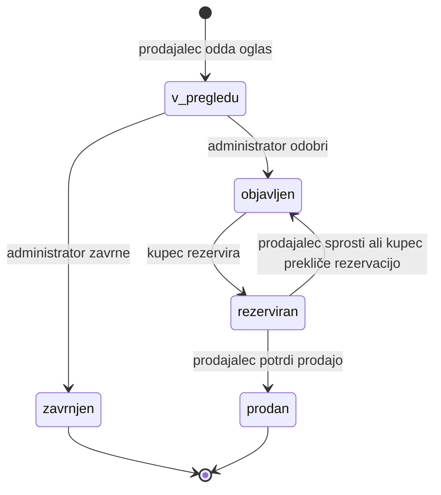
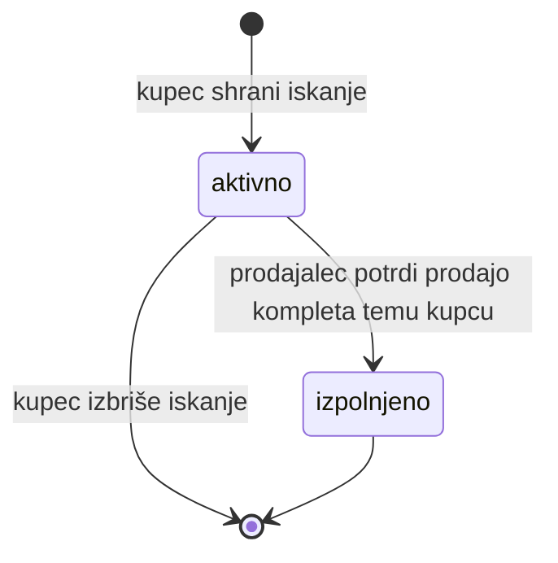

# 02 – Funkcionalnosti in obseg

## Uporabniške vloge

Vsak uporabniški račun ima v danem trenutku natanko eno aktivno vlogo. Kupec in prodajalec lahko vlogo zamenjata na svojem profilu, zato za nakup in prodajo zadošča en račun. Oglasi, rezervacije in iskanja se ob zamenjavi ohranijo, vendar uporabnik z njimi upravlja samo v ustrezni vlogi: prodajo lahko na primer potrdi le v vlogi prodajalca. Administrator vloge ne more zamenjati.

Objavljene oglase in strani kompletov lahko pregleduje vsak, tudi neprijavljen obiskovalec. Za vse drugo je potrebna prijava; spodnja tabela opisuje, kaj lahko poleg tega počne posamezna vloga.

| Vloga | Kaj lahko počne | Katerih pravic nima |
|---|---|---|
| **Kupec** | Rezervira objavljen oglas, shrani iskanje kompleta in vidi oglase, ki iskanju ustrezajo, pregleduje svoje rezervacije in nakupe, prekliče svojo rezervacijo, na profilu zamenja vlogo v prodajalca. | Ne more oddajati oglasov. Ne vidi oglasov, ki niso objavljeni (v pregledu, zavrnjeni). Ne more rezervirati oglasa, ki ga je sam oddal. Ne vidi rezervacij in iskanj drugih kupcev. Ne more odobravati oglasov ali spreminjati kataloga. |
| **Prodajalec** | Odda oglas za komplet iz kataloga, vidi svoje oglase, njihov status in razlog morebitne zavrnitve, potrdi prodajo ali sprosti rezervacijo, umakne svoj oglas, na profilu zamenja vlogo v kupca. | Ne more rezervirati oglasov ali shranjevati iskanj. Ne vidi iskanj kupcev. Ne more odobriti svojega oglasa. Ne more urejati že oddanega oglasa. Ne more spreminjati tujih oglasov. Ne more spreminjati kataloga. |
| **Administrator** | Pregleduje oglase, ki čakajo na pregled, jih odobri ali z navedbo razloga zavrne ter upravlja katalog kompletov. | Ne more oddajati ali rezervirati oglasov ali shranjevati iskanj. Ne more zamenjati vloge. Ne more spreminjati vsebine oglasa (cena, opis); lahko ga le odobri ali zavrne. Ne more potrditi prodaje namesto prodajalca. |

## Predvidene funkcionalnosti

| # | Funkcionalnost | Opis | Vloga | Oznaka |
|---|---|---|---|---|
| 1 | Registracija in prijava z vlogo | Uporabnik se registrira z imenom, e-pošto in geslom ter izbere začetno vlogo kupca ali prodajalca. Po prijavi vidi samo možnosti svoje trenutne vloge. | vsi | **MVP** |
| 2 | Oddaja oglasa v pregled | Prodajalec izbere komplet iz kataloga ter vpiše stanje (zapečaten, nov, rabljen), ceno in opis. Oglas dobi status »v pregledu« in še ni javno viden. | prodajalec | **MVP** |
| 3 | Pregled oglasov pred objavo | Administrator vidi seznam oglasov v pregledu in vsakega odobri (status »objavljen«) ali zavrne (status »zavrnjen«). Ob zavrnitvi vpiše razlog, ki ga prodajalec vidi pri svojem oglasu. | administrator | **MVP** |
| 4 | Rezervacija oglasa | Kupec na seznamu objavljenih oglasov ali med oglasi, ki ustrezajo njegovemu iskanju, izbere oglas in ga rezervira. Oglas dobi status »rezerviran« in ga drugi kupci ne morejo več rezervirati. Kupcu se prikaže e-poštni naslov prodajalca, prodajalec pa pri oglasu vidi e-poštni naslov kupca. | kupec | **MVP** |
| 5 | Potrditev prodaje ali sprostitev rezervacije | Prodajalec na seznamu svojih oglasov pri rezerviranem oglasu potrdi prodajo (status »prodan«) ali sprosti rezervacijo (oglas je znova »objavljen«). | prodajalec | **MVP** |
| 6 | Zamenjava vloge na profilu | Uporabnik na strani svojega profila zamenja vlogo med kupcem in prodajalcem. Njegovi oglasi, rezervacije in iskanja se ob zamenjavi ohranijo. | kupec, prodajalec | **MVP** |
| 7 | Iskanje kompleta z ujemanjem oglasov | Kupec za komplet iz kataloga shrani iskanje z najvišjo ceno in sprejemljivimi stanji. Pri iskanju vidi objavljene oglase, ki mu ustrezajo, v meniju pa število iskanj z ujemajočimi oglasi. Ko kupi komplet, se iskanje samodejno zaključi. | kupec | **MVP** |
| 8 | Pregled lastnih rezervacij in nakupov | Kupec vidi oglase, ki jih je rezerviral ali kupil, z njihovim statusom in e-poštnim naslovom prodajalca. | kupec | |
| 9 | Stran kompleta s primerjavo cen | Za izbrani komplet so prikazani podatki iz kataloga in vsi objavljeni oglasi zanj, razvrščeni po ceni. | vsi obiskovalci | |
| 10 | Filtriranje oglasov | Obiskovalec objavljene oglase filtrira po temi kompleta, stanju in ceni. | vsi obiskovalci | |
| 11 | Umik oglasa | Prodajalec izbriše svoj oglas, dokler ta ni rezerviran ali prodan. | prodajalec | |
| 12 | Upravljanje kataloga kompletov | Administrator doda nov komplet ali popravi podatke obstoječega. V prvi različici katalog napolni skripta. | administrator | |
| 13 | Preklic rezervacije | Kupec na seznamu svojih rezervacij prekliče rezervacijo. Oglas je znova »objavljen«. | kupec | |

## Življenjski cikel oglasa

Funkcionalnosti 2–5 skupaj sestavljajo delovni proces, v katerem sodelujejo vse tri vloge. Oglas ima vedno natanko en status:

Pravila:

- Vsak prehod lahko izvede samo vloga, ki je navedena ob puščici.
- Prehod je dovoljen samo iz navedenega statusa. Rezervirati je na primer mogoče samo oglas s statusom »objavljen«.
- Administrator pri pregledu preveri, ali so podatki oglasa popolni in skladni (opis ustreza izbranemu kompletu in stanju), ali je cena smiselna in ali je vsebina primerna.
- Prodajo lahko potrdi ali rezervacijo sprosti samo prodajalec, ki je oglas oddal.
- Rezervacijo lahko prekliče samo kupec, ki je oglas rezerviral.
- Rezervacija nima roka veljavnosti: velja, dokler je prodajalec ne sprosti ali kupec ne prekliče.
- Kupec ne more rezervirati oglasa, ki ga je sam oddal (kot prodajalec, pred zamenjavo vloge).
- Oddanega oglasa ni mogoče urejati, ker bi sprememba cene ali opisa obšla pregled. Prodajalec ga lahko umakne in odda novega; tudi po zavrnitvi odda nov oglas.
- Umik oglasa ni status: oglas se izbriše. Mogoč je, dokler oglas ni rezerviran ali prodan.
- Pravila preverja backend.

## Iskanje kompleta

Funkcionalnost 7 je drugi delovni proces. V njem sodelujejo vse tri vloge, del korakov pa backend izvede samodejno:

1. Kupec, ki želenega kompleta ne najde med objavljenimi oglasi, shrani iskanje: komplet iz kataloga, najvišjo ceno in sprejemljiva stanja.
2. Prodajalec odda oglas za ta komplet, administrator ga odobri.
3. Backend ugotovi, da oglas ustreza iskanju, in ga prikaže pri kupčevem iskanju. V kupčevem meniju se ob »Moja iskanja« prikaže število iskanj z ujemajočimi oglasi.
4. Kupec oglas rezervira (funkcionalnost 4), prodajalec po prevzemu potrdi prodajo (funkcionalnost 5).
5. Backend ob potrditvi prodaje kupčevo iskanje za ta komplet samodejno zaključi.

Pravila:

- Oglas ustreza iskanju, če je za isti komplet, ima status »objavljen«, njegova cena ni višja od najvišje cene iskanja, njegovo stanje je med sprejemljivimi stanji in ga ni oddal kupec sam.
- Ujemanje preverja backend ob vsakem prikazu iskanj. Oglas se zato med ujemajočimi pojavi takoj, ko ga administrator odobri ali ko je rezervacija sproščena, in izgine, ko je rezerviran ali umaknjen.
- Kupec ima za isti komplet največ eno aktivno iskanje. Aktivno iskanje lahko kadar koli izbriše; izbris ni status.
- Iskanje dobi status »izpolnjeno«, ko prodajalec potrdi prodajo oglasa za ta komplet kupcu, ki je iskanje shranil.
- Najvišjo ceno in sprejemljiva stanja vidi samo kupec, ki je iskanje shranil. Prodajalci iskanj ne vidijo, zato iskanje ni ponudba prodajalcu (glej Out of scope).

## Kasnejše nadgradnje

- Prijava z Google računom poleg prijave z e-pošto in geslom.
- Fotografije kompleta v oglasu.
- Sporočila med kupcem in prodajalcem znotraj rešitve.
- Ocene prodajalcev po zaključeni prodaji.
- E-poštna obvestila ob spremembi statusa oglasa (odobritev, rezervacija, prodaja).

## Out of scope

- Spletno plačevanje: plačilo poteka neposredno med kupcem in prodajalcem.
- Dostava in sledenje pošiljkam: prevzem si kupec in prodajalec dogovorita sama.
- Preverjanje pristnosti in popolnosti kompleta ter reševanje sporov: administrator pregleda samo vsebino oglasa, reklamacije in vračila urejata kupec in prodajalec sama.
- Prodaja posameznih kock, minifiguric, lastnih modelov in izdelkov drugih znamk: oglas je vedno vezan na cel uradni komplet iz kataloga.
- Dražbe in ponudbe kupcev (licitiranje, protiponudbe): rešitev prikazuje samo ceno, ki jo je določil prodajalec.
