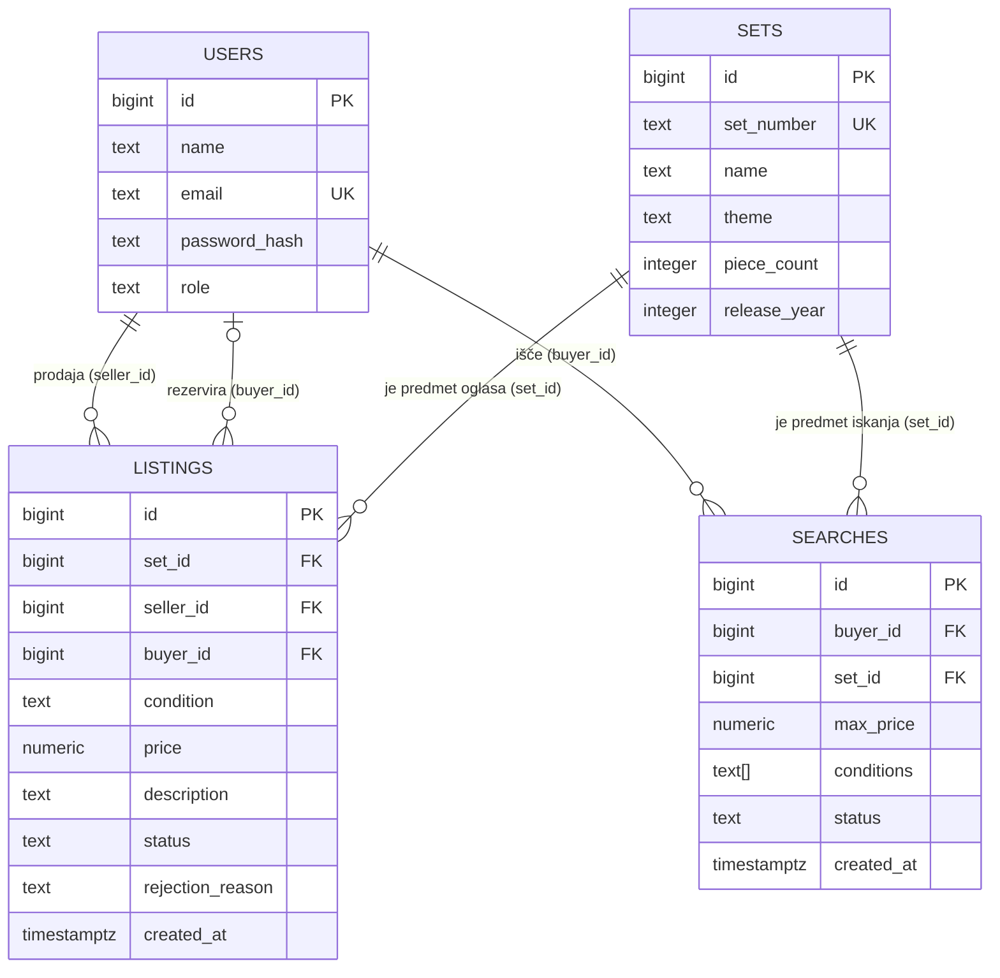

# 03 – Podatkovni model

Podatki so shranjeni v relacijski podatkovni bazi PostgreSQL. Model ima štiri povezane entitete.

## Entitete in glavna polja

### Uporabnik (`users`)

| Polje | Tip | Opis |
|---|---|---|
| `id` | bigint, primarni ključ | Enolična oznaka uporabnika. |
| `name` | text | Ime, ki je prikazano drugim uporabnikom. |
| `email` | text, enolično | E-poštni naslov; uporablja se za prijavo in za dogovor o prevzemu. |
| `password_hash` | text | Zgoščena vrednost gesla. |
| `role` | text | Trenutna aktivna vloga: `buyer` (kupec), `seller` (prodajalec) ali `admin` (administrator). Kupec in prodajalec jo lahko zamenjata na profilu. |

### Komplet (`sets`)

Katalog LEGO kompletov, na katere so vezani oglasi.

| Polje | Tip | Opis |
|---|---|---|
| `id` | bigint, primarni ključ | Enolična oznaka kompleta. |
| `set_number` | text, enolično | Številka kompleta. |
| `name` | text | Ime kompleta. |
| `theme` | text | Tema, na primer City, Technic ali Star Wars. |
| `piece_count` | integer | Število kock. |
| `release_year` | integer | Leto izdaje. |

### Oglas (`listings`)

| Polje | Tip | Opis |
|---|---|---|
| `id` | bigint, primarni ključ | Enolična oznaka oglasa. |
| `set_id` | bigint, tuji ključ → `sets.id` | Komplet, ki se prodaja. |
| `seller_id` | bigint, tuji ključ → `users.id` | Prodajalec, ki je oglas oddal. |
| `buyer_id` | bigint, tuji ključ → `users.id`, lahko prazno | Kupec, ki je oglas rezerviral. Prazno, dokler oglas ni rezerviran; ob sprostitvi ali preklicu rezervacije se izprazni. |
| `condition` | text | Stanje kompleta: `sealed` (zapečaten), `new` (nov) ali `used` (rabljen). |
| `price` | numeric(10, 2) | Cena v evrih. |
| `description` | text, lahko prazno | Opis prodajalca. |
| `status` | text | Status oglasa (glej spodaj). |
| `rejection_reason` | text, lahko prazno | Razlog zavrnitve, ki ga vpiše administrator. Izpolnjeno samo pri zavrnjenem oglasu. |
| `created_at` | timestamptz | Čas oddaje oglasa. |

Vrednosti polja `status`:

| Vrednost | Pomen |
|---|---|
| `pending` | v pregledu |
| `approved` | objavljen |
| `rejected` | zavrnjen |
| `reserved` | rezerviran |
| `sold` | prodan |

### Iskanje (`searches`)

Iskanje kompleta, ki ga shrani kupec.

| Polje | Tip | Opis |
|---|---|---|
| `id` | bigint, primarni ključ | Enolična oznaka iskanja. |
| `buyer_id` | bigint, tuji ključ → `users.id` | Kupec, ki je iskanje shranil. |
| `set_id` | bigint, tuji ključ → `sets.id` | Komplet, ki ga kupec išče. |
| `max_price` | numeric(10, 2) | Najvišja cena v evrih, ki jo je kupec pripravljen plačati. Vidi jo samo kupec. |
| `conditions` | text[] | Sprejemljiva stanja: ena ali več vrednosti `sealed`, `new`, `used`. |
| `status` | text | `active` (aktivno) ali `fulfilled` (izpolnjeno). |
| `created_at` | timestamptz | Čas shranitve iskanja. |

Kupec ima za isti komplet največ eno aktivno iskanje (enolični indeks nad `buyer_id` in `set_id` za vrstice s statusom `active`).

Ujemajoči oglasi niso shranjeni v svoji tabeli. Backend jih poišče s poizvedbo nad tabelo `listings`: isti `set_id`, status `approved`, `price <= max_price`, `condition` je v `conditions` in `seller_id` ni enak `buyer_id` iskanja.

## Povezave med entitetami

- **Uporabnik – oglas (prodajalec), 1 : N.** En prodajalec ima lahko več oglasov; vsak oglas ima natanko enega prodajalca (`listings.seller_id`).
- **Uporabnik – oglas (kupec), 0..1 : N.** En kupec lahko rezervira ali kupi več oglasov; oglas ima največ enega kupca (`listings.buyer_id`).
- **Komplet – oglas, 1 : N.** Za en komplet je lahko več oglasov; vsak oglas je vezan na natanko en komplet (`listings.set_id`).
- **Uporabnik – iskanje, 1 : N.** En kupec ima lahko več iskanj; vsako iskanje pripada natanko enemu kupcu (`searches.buyer_id`).
- **Komplet – iskanje, 1 : N.** Za en komplet je lahko več iskanj različnih kupcev; vsako iskanje je vezano na natanko en komplet (`searches.set_id`).

Isti uporabnik je lahko prodajalec enih oglasov in kupec drugih. Polja `seller_id`, `buyer_id` in `searches.buyer_id` namreč niso odvisna od trenutne vloge uporabnika, zato se ob zamenjavi vloge njegovi oglasi, rezervacije in iskanja ohranijo.

## Osnutek podatkovnega modela

