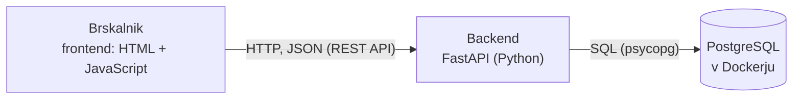

# 04 – Arhitektura in tehnološki sklad

## Arhitektura

### Glavni deli sistema

| Del | Naloga |
|---|---|
| **Frontend** | Strani HTML z JavaScriptom, ki tečejo v brskalniku. Vsebina strani ni vnaprej zapisana: JavaScript podatke (oglase, komplete, podatke o prijavljenem uporabniku) pridobi iz backenda in jih prikaže, vnose iz obrazcev pa pošlje backendu. |
| **Backend** | Aplikacija FastAPI (Python). Ponuja REST API, preverja prijavo in vlogo uporabnika, preverja pravila delovnih procesov (prehodi med statusi oglasa, ujemanje oglasov z iskanji) in izvaja poizvedbe SQL. Brskalniku streže tudi datoteke frontenda. |
| **Podatkovna baza** | PostgreSQL s tabelami `users`, `sets`, `listings` in `searches`. |

### Komunikacija med deli sistema

- **Brskalnik → backend:** zahtevki HTTP s funkcijo `fetch`, podatki v obliki JSON (REST API). Primeri: `POST /listings` (oddaja oglasa), `POST /listings/{id}/approve` (odobritev), `POST /listings/{id}/reserve` (rezervacija).
- **Backend → podatkovna baza:** poizvedbe SQL prek knjižnice psycopg.
- Frontend do podatkovne baze nikoli ne dostopa neposredno.

### Diagram

### Podatkovna baza

Relacijska podatkovna baza PostgreSQL s štirimi tabelami, opisanimi v `03-podatkovni-model.md`. Shema je zapisana v datoteki SQL, ki se izvede ob prvem zagonu baze. Baza teče v Dockerjevem zabojniku. Ker se datoteka s shemo izvede samo ob prvem zagonu, se ob spremembi sheme razvojna baza izbriše in ustvari na novo (`docker compose down -v`, nato `docker compose up -d` in skripta za začetne podatke).

### Avtentikacija in upravljanje uporabnikov

- **Registracija:** uporabnik vpiše ime, e-pošto in geslo ter izbere vlogo kupca ali prodajalca.
- **Geslo** se v bazo shrani samo kot zgoščena vrednost (bcrypt).
- **Prijava:** backend preveri e-pošto in geslo ter v sejo zapiše oznako uporabnika in njegovo vlogo. Seja je shranjena v podpisanem piškotku, ki ga brskalnik pošlje z vsakim zahtevkom.
- **Preverjanje pravic:** objavljene oglase in strani kompletov je mogoče pregledovati brez prijave. Vsaka druga končna točka API preveri, ali je uporabnik prijavljen in ali ima zahtevano vlogo.
- **Zamenjava vloge:** ko kupec ali prodajalec na profilu zamenja vlogo, backend posodobi polje `role` v bazi in vlogo v seji.
- **Administratorski račun** ne nastane z registracijo; ustvari ga skripta za začetne podatke.
- **Odjava** izbriše sejo.

### Lokalni zagon

Potrebni so Docker Desktop, Python in ključ za Brickset API. Podrobni ukazi so v `README.md`.

1. Kopiranje `.env.example` v `.env` in vpis vrednosti (geslo baze, ključ za Brickset API, administratorski račun).
2. `docker compose up -d` – zažene PostgreSQL in ob prvem zagonu ustvari tabele.
3. `python -m venv .venv`, aktivacija okolja in `pip install -r requirements.txt` – namesti knjižnice backenda.
4. `python seed/seed.py` – napolni katalog kompletov iz Brickset API in ustvari administratorski račun.
5. `uvicorn backend.main:app --reload` – zažene backend, ki streže tudi frontend.
6. Rešitev je dostopna na naslovu `http://127.0.0.1:8000`.

## Tehnološki sklad

| Del | Tehnologije in orodja |
|---|---|
| Frontend | HTML, CSS, JavaScript (vgrajena funkcija `fetch`) |
| Backend | Python, FastAPI, Uvicorn, psycopg3 |
| Podatkovna baza | PostgreSQL |
| Avtentikacija | E-pošta in geslo, zgoščevanje gesel s knjižnico bcrypt, seja v podpisanem piškotku (SessionMiddleware iz ogrodja Starlette, na katerem temelji FastAPI) |
| Lokalni razvoj | Docker Desktop in Docker Compose (podatkovna baza), virtualno okolje Python (venv), Visual Studio Code, Git |
| Drugo | Skripta v Pythonu za začetne podatke (katalog kompletov iz Brickset API, administratorski račun) |

## Arhitekturne odločitve

Vsaka odločitev je s kontekstom, obravnavanimi možnostmi in posledicami podrobneje opisana v svojem zapisu ADR v direktoriju [`adr/`](adr/).

- **Ločena frontend in backend z REST API.** Meja med deloma je jasna, zato je mogoče frontend kasneje zamenjati ali dodati drugega odjemalca, ne da bi spreminjali backend.
- **Frontend brez ogrodja.** Rešitev ima malo strani, zato ogrodje ni potrebno; ni koraka gradnje in koda je lažje razumljiva.
- **FastAPI.** Za REST API je potrebne malo kode, vhodne podatke preverja samodejno, na naslovu `/docs` pa samodejno ponudi dokumentacijo API, s katero je mogoče končne točke preizkusiti.
- **Poizvedbe SQL brez ORM.** Model ima štiri tabele in poizvedbe so kratke, zato dodaten sloj ni potreben.
- **PostgreSQL.** Podatki so povezani (oglas pripada kompletu in uporabniku), zato je primerna relacijska baza; tuji ključi in omejitve skrbijo, da so povezave in statusi veljavni.
- **Podatkovna baza v Dockerju.** Baza se na vsakem računalniku zažene z enim ukazom, brez nameščanja PostgreSQL.
- **Seja v podpisanem piškotku in bcrypt.** Rešitev ne potrebuje zunanje storitve za prijavo, gesla pa niso shranjena v berljivi obliki. Ker backend streže tudi frontend, sta oba na istem naslovu in piškotek deluje brez dodatnih nastavitev.
- **Ena aktivna vloga na račun.** Preverjanje pravic je preprosto: končna točka primerja vlogo iz seje z zahtevano vlogo. Uporabnik, ki želi kupovati in prodajati, vlogo zamenja na profilu in ne potrebuje dveh računov.
- **Pravila delovnega procesa v backendu.** Prehode med statusi oglasa in ujemanje oglasov z iskanji preverja backend, ker je zahtevke mogoče poslati tudi mimo frontenda.
- **Katalog kompletov iz Brickset API.** Skripta za začetne podatke prenese resnične komplete, zato jih ni treba vpisovati ročno; za lokalni zagon je potreben brezplačen ključ za Brickset API.
