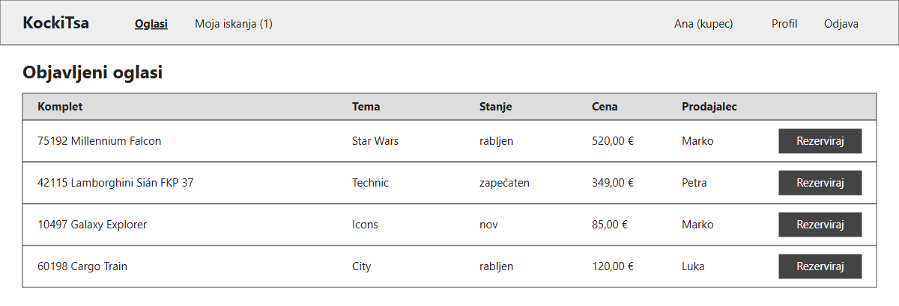
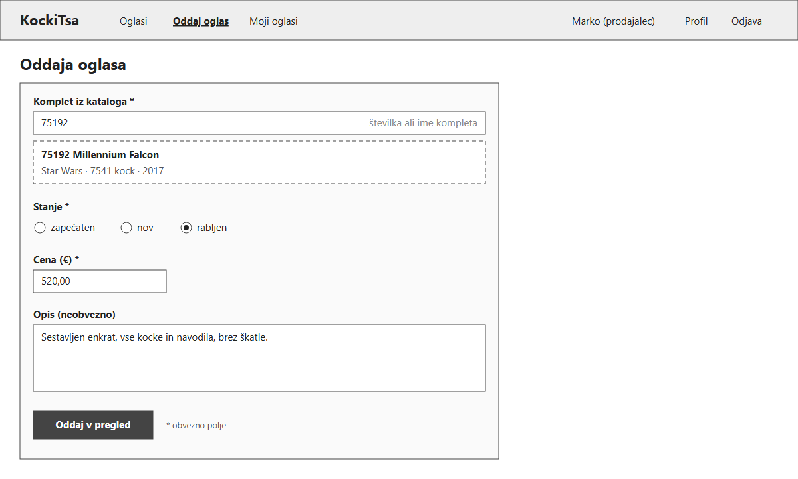
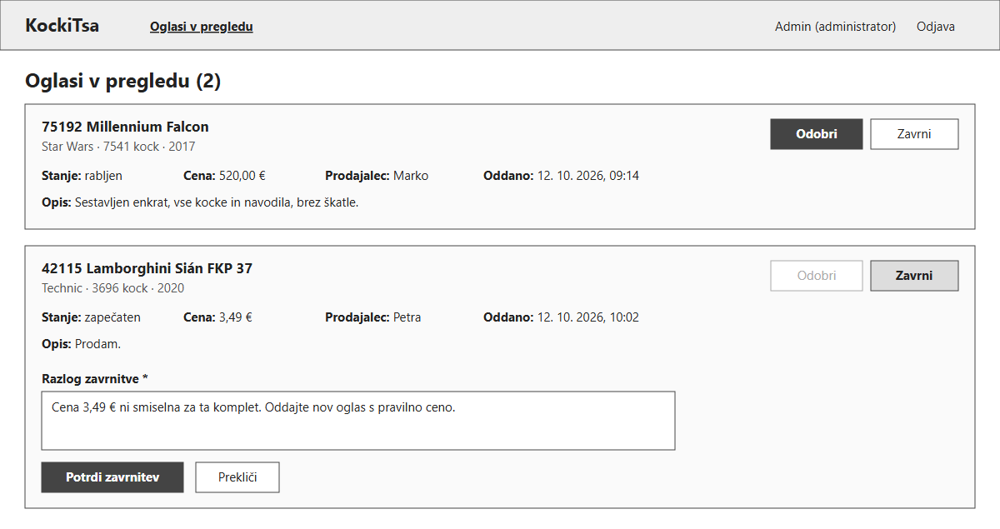
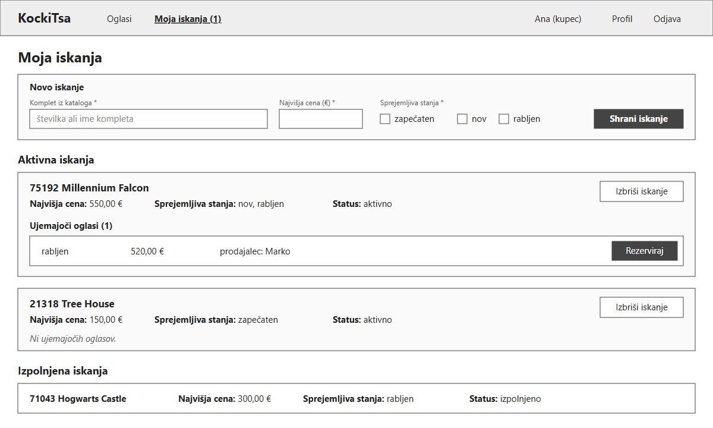

# 06 – Wireframes

## WF-01 – Objavljeni oglasi (pogled kupca)

Začetna stran rešitve. Prikazuje seznam oglasov s statusom »objavljen«, ki je viden tudi brez prijave. Gumb »Rezerviraj« je prikazan samo prijavljenemu kupcu (US-07); po rezervaciji se kupcu prikaže e-poštni naslov prodajalca (US-08). Število ob »Moja iskanja« v meniju opozarja na iskanja z ujemajočimi oglasi (US-14).

## WF-02 – Oddaja oglasa (pogled prodajalca)

Obrazec, s katerim prodajalec odda oglas (US-03). Komplet poišče po številki ali imenu in ga izbere iz kataloga, nato se pod poljem prikažejo podatki kompleta. Vpiše še stanje, ceno in neobvezen opis. Po kliku na »Oddaj v pregled« dobi oglas status »v pregledu« in še ni javno viden.

## WF-03 – Oglasi v pregledu (pogled administratorja)

Seznam oglasov, ki čakajo na pregled. Pri vsakem oglasu so prikazani podatki kompleta, stanje, cena, prodajalec, čas oddaje in opis. Prvi oglas prikazuje osnovno stanje z gumboma »Odobri« (US-05) in »Zavrni«. Drugi oglas prikazuje stanje po kliku na »Zavrni«: odpre se polje za razlog, brez katerega zavrnitve ni mogoče potrditi (US-06).

## WF-04 – Moja iskanja (pogled kupca)

Na vrhu je obrazec za novo iskanje: komplet iz kataloga, najvišja cena in sprejemljiva stanja (US-13). Pod njim so aktivna iskanja; pri vsakem so prikazani ujemajoči oglasi z gumbom »Rezerviraj« ali sporočilo »Ni ujemajočih oglasov« (US-14). Na dnu so izpolnjena iskanja, ki jih je rešitev zaključila ob potrditvi prodaje, aktivna iskanja pa je mogoče izbrisati (US-15).
